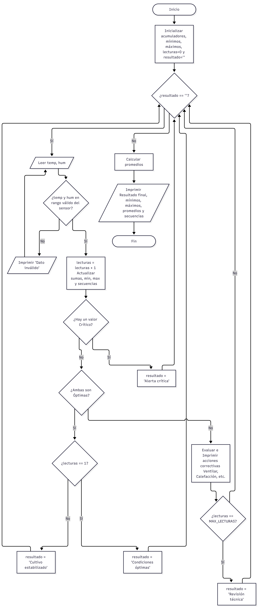

# Sistema de Control de Invernadero

## Integrantes
* Darwin Samuel Machuca Gonzalez
* Bladimir Ferney Bermudez Toloza

Este repositorio contiene la solucion al parcial de la asignatura Programacion 1 para el programa de Ingenieria en Ciencias de la Computacion e Inteligencia Artificial de la Universidad de Santander (UDES). El sistema gestiona y monitorea las variables ambientales de un invernadero en tiempo real.

## Informacion Academica
* **Asignatura:** Programacion 1
* **Docente:** Ing. Carlos Carrascal

## Informacion Academica

Video

## 📚 Material de Referencia
* **Preparcial:** [Ver documento original](https://drive.google.com/file/d/1_oEwsjpJ8Wd8K8u2_zg4hnzE5BgXqJSu/view?usp=sharing)


## Diagrama de flujo


## 🎥 Demostración del proyecto

[video Explicativo]()

## Descripcion del Problema y Reglas de Negocio
El sistema de control del invernadero funciona bajo los siguientes requerimientos funcionales:

* **Lectura de variables:** El sistema solicita y registra los datos actuales de temperatura y humedad del entorno.
* **Evaluacion de estado:** Mediante una validacion logica, el algoritmo clasifica el estado del invernadero como optimo o critico dependiendo de los rangos preestablecidos.
* **Acciones correctivas:** Si las condiciones son criticas, el sistema emite de forma automatizada la orden de "ventilar" o "nebulizar" segun sea necesario para estabilizar el ambiente.

## Contenido del Repositorio

```text
.
├── README.md                 # Documentacion del proyecto (Este archivo)
├── diagrama_Dfd_parcial.png  # Diagrama de Flujo de Datos
├── parcial.py                # Script principal con la logica del parcial en Python
└── Preparcial.pdf            # Documento original del preparcial